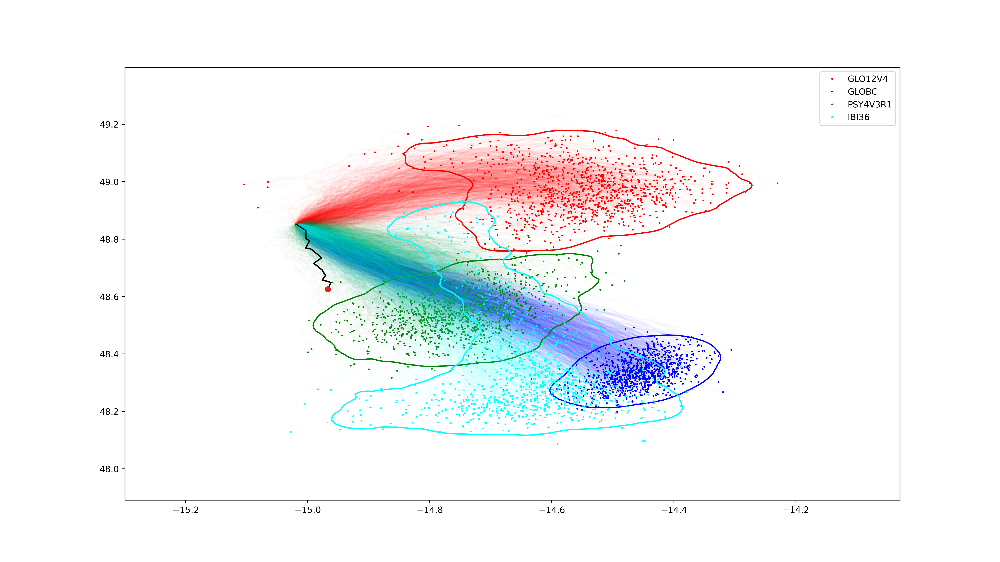
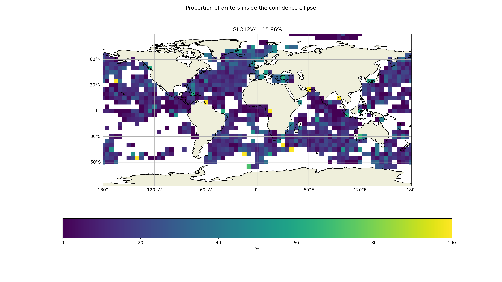
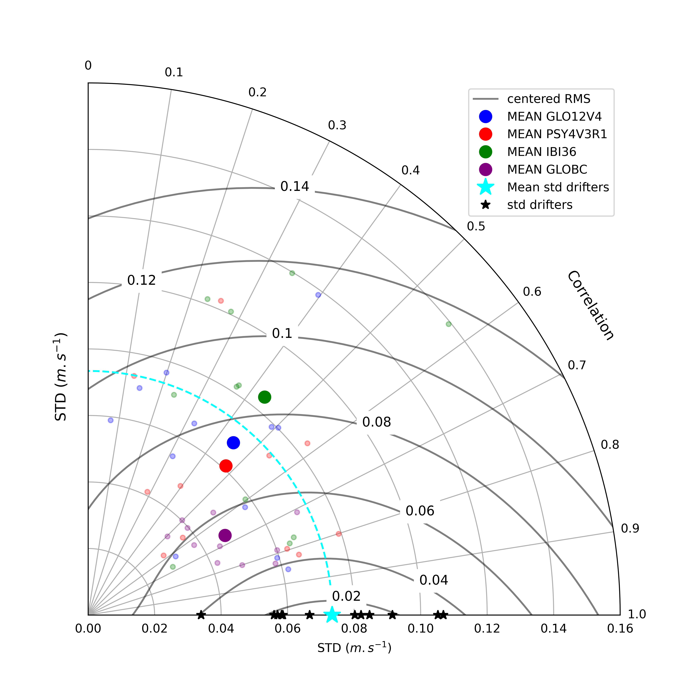

# Validation_Tools_drifters

## Installation
This code is adapted to work on Fidji. Brefore execution, the envirenment env_py311 should be launched following the command : 'conda activate env_py311'

## Description
This study aims to compare the models and the trajecttories of the drifters for a period of three monthes with a Lagrangian perspective and so, three different scores are generated. 

The first score is the Liu Skill Score, which assesses the models' ability to accurately represent the overall trajectory. The second score is the Separation Distance, which measures how effectively the models can guide particles to positions closest to the drifter's location at the end of the drift time. Lastly, the correlation of Pearson is used to evaluate the directional accuracy of the scores in terms of latitude and longitude.

This code contains two main scripts to be launched consecutively:
-the first script 'Lagrangian_tool_traj_compute_fidji.py' allows the calculation of the trajectories
-the second one 'Lagrangian_tool_lagrangian_scores_more_fidji.py' calculates the scores and plot them.

The first script is automated and it computes all the cases of study. 

Thereby, there is three loops :
-the first loop is on the models (for the moment we take only GLO12, but the code is adapted to contain more then one model).
-the second loop is on the drift time (we take the values 1,3,5,7).
-the third loop is on the mode ('FCT' : forecast, 'ANA' : analysis).
However, for the second script, there is no automatization and the computing of scores will be made separately for each case of staudy. Then, the configuration file will be adapted for each of those cases. 

## Basic Usage
Set your parameters into the config_fidji.ini file.
Those parameters define the case to be studied. And so, there is 2 different categpries of paramters :
1- the paramaters which are constant for all the cases
2- the parameters which are defined automatically with 'Lagrangian_tool_traj_compute_fidji.py' but the user have to define them within config_fidji.ini before applying 'Lagrangian_tool_lagrangian_scores_more_fidji.py'.

### First category 
-the area parameters: ('lon_min', 'lon_max', 'lat_min', 'lat_max'). In this bulletin, the staudy is made globally but the user can make tests over smaller zones.
-the layer parameter 'depth'. Here, study is made at 15m below sea surface.
-the number of monthes for which the evaluation is made 'N_MONTHES'. For this bulletin, the evalation is made for a complete trimester and then this paramter is always equal to 3. Of course, user can modify it for tests. 
-there is also, the parameters of user ('username' and 'PASSWORD') and the pathes (prject path ' PROJECT', code path 'dir_in', path for stocking results 'dir_work')
-and the advanced parameters : 'copernicus_drifter' (always = True), the diffusion parameter 'AdvectionDiffusion_type' (=k_smag), the number of repetions 'nb_repeats' (= 1000) and the boolean indicator 'remote' (= True).

### Second category
-the model parmameter 'MODELS'. For the moment we study only the GLO12 model but code can be applied on more models like PSY4.
-the number of days for drifting 'DRIFT_TIME' (=1,3,5,7). 
-the starting date 'MONTH_YEAR' which contain the year of the trimester preceded by its first month (e.g. 012024 for winter 2024, 042024 for spring, 072024 for summer and 102024 for automn).
-the boolean parmeter defining the mode 'Forecast' (= True for forecast and = False for analysis). 
-the label of stay case 'EXP_NAME'. This value affected to this parameter may have this format (fidji_012024_3M_DT7_FCT, wherein the value _012024_ corresponds the parameter 'MONTH_YEAR', the value '_3M_' represents the length of the trimester, '_DT7_' indicates the drift time of 7 days, and _FCT indicates the forecast mode). For example, for spring 2024 with 3 monthes of drfiting in analysis mode, this parameter is equal to fidji_042024_3M_DT3_ANA.

## Trajects computing
The function which calculates the trajectories is in traj_compute_fidji.py.
This function is about the calculation of trajectory.
The trajectory is calculated by this function. 
 
## Scores computing
This function calculates and plots the different scores.
The scores are calculated and plotted by this function.
For this reason, this function is used.
To identify the difference between the different drifters, we apply this function.
 
## Functions
For this approach, there is two functions to implement:
The first function is about conducting work about the computing of trajectories meanwhile the second one is more about.

## Outputs
Then you will find your figures in the Folder name : PLOT
Lagrangian_tool_lagrangian_scores_more.ipynb is a jupyter notebook that gives more information about the Lagrangian_tool_lagrangian_scores.py, 

## Some examples

